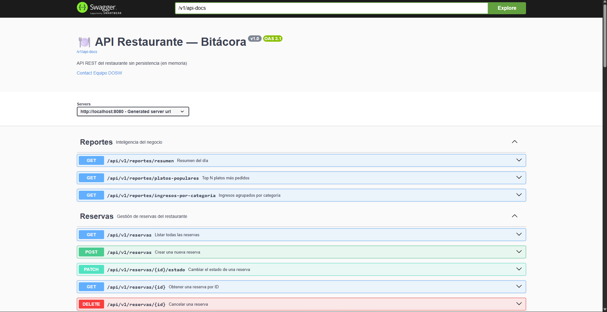
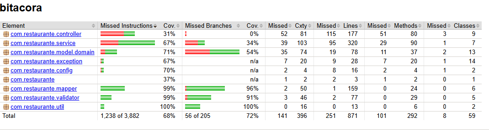
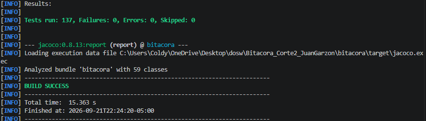
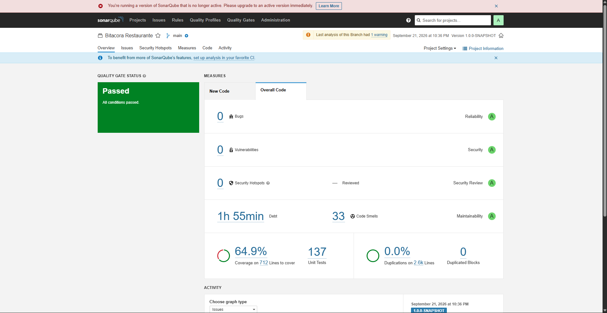

# 🍣 Sakura Sushi — API REST

API REST que digitaliza la operación de **Sakura Sushi**, una barra de sushi con preparación por lotes y rolls armados a pedido. Construida con arquitectura MVC en capas, MapStruct, Lombok, Spring Data JPA, MongoDB, JWT, JUnit 5, Mockito, JaCoCo, SonarQube y Springdoc OpenAPI.

---

## 📑 Índice

- [Autor](#-autor)
- [Concepto del restaurante](#-concepto-del-restaurante)
- [Descripción](#-descripción)
- [Arquitectura](#-arquitectura)
- [Estructura de paquetes](#-estructura-de-paquetes)
- [Funcionalidades](#-funcionalidades)
- [Endpoints](#-endpoints)
- [Reglas de negocio](#-reglas-de-negocio)
- [Seguridad](#-seguridad)
- [Stack técnico](#-stack-técnico)
- [Cómo ejecutar](#-cómo-ejecutar)
- [Ejecución con Docker](#-ejecución-con-docker)
- [Guía de uso con Swagger](#-guía-de-uso-con-swagger)
- [Pruebas](#-pruebas)
- [CI/CD](#-cicd)
- [Decisiones de diseño](#-decisiones-de-diseño)
- [Evidencias](#-evidencias)

---

## 👤 Autor

**Juan Garzón** — DOSW Grupo 1

Escuela Colombiana de Ingeniería

---

## 🍱 Concepto del restaurante

- Los rolls se preparan en **tandas de máximo 6 unidades** para mantener el ritmo de la barra.
- Los ingredientes agotados bloquean la creación de rolls que los usen.
- Los pedidos se asocian automáticamente a la cuenta abierta de la mesa.
- Flujo de estados del pedido: `RECIBIDO → EN_PREPARACION → LISTO → ENTREGADO`.
- Una mesa solo puede tener **una cuenta abierta** a la vez.

---

## 📖 Descripción

API REST que digitaliza la operación de Sakura Sushi: gestión de carta, pedidos, mesas, cuentas, reservas, ingredientes, parqueadero, tandas de rolls y reportes.

**Arquitectura híbrida de persistencia:**

- **H2 (modo PostgreSQL)** → datos relacionales (platos, mesas, pedidos, cuentas, reservas, ingredientes, parqueadero, usuarios).
- **MongoDB** → datos de estructura flexible (tandas de preparación).

---

## 🏛️ Arquitectura

```
Cliente (Swagger / Postman / Frontend)
       │
       ▼
┌─────────────────────────────────────────┐
│  Security Filter (JWT)                  │
└─────────────────────────────────────────┘
       │
       ▼
┌─────────────────────────────────────────┐
│  Controller    →  Recibe HTTP, valida   │
│                  @Valid, delega, responde│
└─────────────────────────────────────────┘
       │
       ▼
┌─────────────────────────────────────────┐
│  Mapper (Controller ↔ Dominio)          │
└─────────────────────────────────────────┘
       │
       ▼
┌─────────────────────────────────────────┐
│  Service       →  Orquesta, aplica      │
│                  lógica, usa Streams    │
└─────────────────────────────────────────┘
       │
       ├──▶ Validator   →  Reglas puras
       │
       ▼
┌─────────────────────────────────────────┐
│  Dominio       →  Objetos de negocio    │
└─────────────────────────────────────────┘
       │
       ▼
┌─────────────────────────────────────────┐
│  Mapper (Dominio ↔ Entity/Document)     │
└─────────────────────────────────────────┘
       │
       ▼
┌─────────────────────────────────────────┐
│  Repository    →  JPA (H2) o MongoDB    │
└─────────────────────────────────────────┘
```

### Responsabilidades por capa

| Capa | Qué hace | Qué NO hace |
|------|----------|-------------|
| **Controller** | Recibe HTTP, delega, responde | No tiene lógica de negocio |
| **Service** | Orquesta, aplica reglas | No conoce HTTP, no convierte DTOs |
| **Validator** | Aplica reglas de negocio puras | No conoce HTTP ni DTOs |
| **Mapper** | Traduce entre 3 capas | No tiene lógica de negocio |
| **Dominio** | Objetos con comportamiento propio | No conoce Spring ni JPA |
| **Entity/Document** | Estructura de persistencia | No tiene lógica de negocio |
| **Repository** | Acceso a datos | No conoce HTTP |
| **ExceptionHandler** | Respuestas uniformes | No conoce reglas |

### El Mapper tiene 3 capas

```
RequestDTO ↔ Dominio ↔ Entity (JPA / H2)
                  ↕
              Document (MongoDB)
```

- `PlatoMapper` → RequestDTO ↔ Dominio (usado por el Controller)
- `PlatoEntityMapper` → Dominio ↔ PlatoEntity (usado por el Service)
- `TandaDocumentMapper` → Dominio/DTO ↔ TandaDocument (usado por el Service de Tanda)

---

## 📂 Estructura de paquetes

```
com.restaurante
├── controller/           → Endpoints REST + GlobalExceptionHandler
├── service/              → Interfaces + implementaciones en service/impl
├── validator/            → Reglas de negocio
├── mapper/               → MapStruct (presentación + persistencia)
├── util/                 → Utilidades compartidas
├── model/
│   ├── domain/           → Entidades puras + enums
│   └── dto/
│       ├── request/      → DTOs de entrada (@Valid)
│       └── response/     → DTOs de salida
├── persistence/          → Clases de infraestructura de datos
│   ├── entity/           → Entidades JPA (@Entity) — H2
│   └── document/         → Documentos Mongo (@Document) — MongoDB
├── repository/           → JpaRepository + MongoRepository
├── security/             → JWT, filtros, configuración de seguridad
├── exception/            → Excepciones propias
└── config/               → Swagger + CORS + DataSeeder
```

---

## 🎯 Funcionalidades

| # | Funcionalidad | Descripción | Persistencia |
|---|--------------|-------------|:------------:|
| 1 | **Carta y Platos** | Rolls, sashimis, nigiris con disponibilidad | H2 (JPA) |
| 2 | **Menú del Cliente** | Vista filtrada solo de platos disponibles | — |
| 3 | **Ingredientes** | Catálogo para personalización de rolls | H2 (JPA) |
| 4 | **Pedidos** | Flujo completo con transiciones de estado | H2 (JPA) |
| 5 | **Tandas** | Preparación por lotes de máximo 6 rolls | **MongoDB** |
| 6 | **Mesas** | Apertura y cierre de cuentas | H2 (JPA) |
| 7 | **Cuentas** | Consolidación automática de pedidos y cierre | H2 (JPA) |
| 8 | **Reservas** | Validación de conflictos de horario y capacidad | H2 (JPA) |
| 9 | **Parqueadero** | Entrada/salida con cálculo de cobro | H2 (JPA) |
| 10 | **Reportes** | Consolidados con Streams | — |
| 11 | **Autenticación JWT** | Login y roles por endpoint | H2 (JPA) |

---

## 🌐 Endpoints

### AuthController — `/auth`

| Verbo | Endpoint | Éxito | Errores |
|-------|----------|-------|---------|
| POST | `/auth/login` | 200 | 400, 401 |
| POST | `/auth/registro` | 201 | 400, 409 |

### PlatoController — `/api/v1/platos`

| Verbo | Endpoint | Éxito | Errores |
|-------|----------|-------|---------|
| GET | `/api/v1/platos` | 200 | — |
| GET | `/api/v1/platos/{id}` | 200 | 404 |
| GET | `/api/v1/platos/categoria/{cat}` | 200 | — |
| POST | `/api/v1/platos` | 201 | 400, 409, 403 |
| PUT | `/api/v1/platos/{id}` | 200 | 400, 404, 409, 403 |
| PATCH | `/api/v1/platos/{id}/disponible` | 200 | 404, 403 |
| DELETE | `/api/v1/platos/{id}` | 204 | 404, 403 |

### MenuController — `/api/v1/menu`

| Verbo | Endpoint | Éxito | Errores |
|-------|----------|-------|---------|
| GET | `/api/v1/menu` | 200 | — |
| GET | `/api/v1/menu/{id}` | 200 | 404 |
| GET | `/api/v1/menu/categoria/{cat}` | 200 | — |

### IngredienteController — `/api/v1/ingredientes`

| Verbo | Endpoint | Éxito | Errores |
|-------|----------|-------|---------|
| GET | `/api/v1/ingredientes` | 200 | — |
| GET | `/api/v1/ingredientes/disponibles` | 200 | — |
| GET | `/api/v1/ingredientes/tipo/{tipo}` | 200 | — |
| GET | `/api/v1/ingredientes/{id}` | 200 | 404 |
| POST | `/api/v1/ingredientes` | 201 | 400, 409, 403 |
| PATCH | `/api/v1/ingredientes/{id}/disponible` | 200 | 404, 403 |
| DELETE | `/api/v1/ingredientes/{id}` | 204 | 404, 403 |

### PedidoController — `/api/v1/pedidos`

| Verbo | Endpoint | Éxito | Errores |
|-------|----------|-------|---------|
| GET | `/api/v1/pedidos` | 200 | — |
| GET | `/api/v1/pedidos/activos` | 200 | — |
| GET | `/api/v1/pedidos/mesa/{idMesa}` | 200 | — |
| GET | `/api/v1/pedidos/{id}` | 200 | 404 |
| POST | `/api/v1/pedidos` | 201 | 400, 404, 422, 403 |
| POST | `/api/v1/pedidos/{id}/items` | 200 | 404, 422, 403 |
| PUT | `/api/v1/pedidos/{id}/items/{idPlato}` | 200 | 404, 422, 403 |
| DELETE | `/api/v1/pedidos/{id}/items/{idPlato}` | 200 | 404, 422, 403 |
| PATCH | `/api/v1/pedidos/{id}/estado` | 200 | 404, 422, 403 |
| DELETE | `/api/v1/pedidos/{id}` | 204 | 404, 422, 403 |

### TandaController — `/api/v1/tandas` (MongoDB)

| Verbo | Endpoint | Éxito | Errores |
|-------|----------|-------|---------|
| GET | `/api/v1/tandas` | 200 | — |
| POST | `/api/v1/tandas` | 201 | 404, 422, 403 |

### MesaController — `/api/v1/mesas`

| Verbo | Endpoint | Éxito | Errores |
|-------|----------|-------|---------|
| GET | `/api/v1/mesas` | 200 | — |
| GET | `/api/v1/mesas/disponibles` | 200 | — |
| GET | `/api/v1/mesas/{id}` | 200 | 404 |
| POST | `/api/v1/mesas` | 201 | 400, 409, 403 |
| PATCH | `/api/v1/mesas/{id}/abrir` | 200 | 404, 422, 403 |
| PATCH | `/api/v1/mesas/{id}/cerrar` | 200 | 404, 422, 403 |
| DELETE | `/api/v1/mesas/{id}` | 204 | 404, 422, 403 |

### CuentaController — `/api/v1/cuentas`

| Verbo | Endpoint | Éxito | Errores |
|-------|----------|-------|---------|
| GET | `/api/v1/cuentas` | 200 | — |
| GET | `/api/v1/cuentas/{id}` | 200 | 404 |
| GET | `/api/v1/cuentas/mesa/{idMesa}` | 200 | 404 |
| POST | `/api/v1/cuentas/mesa/{idMesa}` | 201 | 404, 422, 403 |
| PATCH | `/api/v1/cuentas/{id}/cerrar` | 200 | 404, 422, 403 |

### ReservaController — `/api/v1/reservas`

| Verbo | Endpoint | Éxito | Errores |
|-------|----------|-------|---------|
| GET | `/api/v1/reservas` | 200 | — |
| GET | `/api/v1/reservas/vigentes` | 200 | — |
| GET | `/api/v1/reservas/cliente/{cliente}` | 200 | — |
| GET | `/api/v1/reservas/{id}` | 200 | 404 |
| POST | `/api/v1/reservas` | 201 | 400, 404, 409, 422, 403 |
| PATCH | `/api/v1/reservas/{id}/estado` | 200 | 404, 422, 403 |
| DELETE | `/api/v1/reservas/{id}` | 204 | 404, 422, 403 |

### ParqueaderoController — `/api/v1/parqueadero`

| Verbo | Endpoint | Éxito | Errores |
|-------|----------|-------|---------|
| POST | `/api/v1/parqueadero/entrada` | 201 | 400, 409, 403 |
| POST | `/api/v1/parqueadero/salida/{placa}` | 200 | 404, 403 |
| GET | `/api/v1/parqueadero/activos` | 200 | — |
| GET | `/api/v1/parqueadero/estado` | 200 | — |
| GET | `/api/v1/parqueadero/placa/{placa}` | 200 | — |

### ReporteController — `/api/v1/reportes`

| Verbo | Endpoint | Éxito | Errores |
|-------|----------|-------|---------|
| GET | `/api/v1/reportes/resumen` | 200 | 403 |
| GET | `/api/v1/reportes/ingresos-por-categoria` | 200 | 403 |
| GET | `/api/v1/reportes/platos-populares?top=N` | 200 | 403 |

---

## 📜 Reglas de negocio

### Reglas específicas de Sakura Sushi

1. **Tandas de máximo 6 rolls** — Los rolls se preparan en lotes de máximo 6 unidades.
2. **Solo ROLLs en una tanda** — Un té verde o un postre no pueden ir en una tanda.
3. **Rolls disponibles** — Si un roll está agotado, no se puede incluir.
4. **Rolls existentes** — Cada ID en la tanda debe existir en la carta.
5. **Auto-asociación de pedido a cuenta** — Al crear un pedido, se agrega automáticamente a la cuenta abierta de la mesa.

### Reglas generales

6. **Pedido requiere mesa con cuenta abierta.**
7. **Platos disponibles** — No se pueden pedir platos agotados.
8. **Modificar solo en RECIBIDO.**
9. **Transiciones de estado válidas** — `RECIBIDO → EN_PREPARACION → LISTO → ENTREGADO`.
10. **Cuenta no cierra con pedidos activos.**
11. **Una cuenta por mesa.**
12. **Mesa no se elimina con cuenta abierta.**
13. **Plato no se elimina con pedidos activos.**
14. **Conflicto de reservas** — No pueden solaparse reservas vigentes en la misma mesa.
15. **Comensales ≤ capacidad de mesa.**
16. **Precio congelado** — El `ItemPedido` congela el precio al momento del pedido.

---

## 🔐 Seguridad

La API está protegida con **JWT (JSON Web Token)**. Todos los endpoints, excepto los públicos, requieren un token válido en el header `Authorization: Bearer <token>`.

### Roles del sistema

| Rol | Puede hacer | No puede |
|-----|-------------|----------|
| `GERENTE` | CRUD platos, mesas, ingredientes, ver reportes | — |
| `MESERO` | Ver menú, abrir/cerrar cuentas, crear pedidos | Eliminar platos, ver reportes |
| `COCINERO` | Ver pedidos, cambiar estado, crear tandas | Crear platos, ver cuentas |
| `CLIENTE` | Ver menú, crear reservas | Acceder a admin |

### Endpoints públicos (sin token)

- `POST /auth/login`
- `POST /auth/registro`
- `GET /api/v1/menu/**`
- `GET /swagger-ui/**`, `/v1/api-docs/**`
- `GET /h2-console/**`

### Cómo autenticarse

1. Ejecutar `POST /auth/login` con las credenciales del seeder.
2. Copiar el campo `token` de la respuesta.
3. Usarlo en el header `Authorization: Bearer <token>` en cada petición protegida.

### Usuarios del seeder

| Rol | Email | Password |
|-----|-------|----------|
| Gerente | `gerente@sakura.com` | `gerente123` |
| Mesero | `mesero@sakura.com` | `mesero123` |
| Cocinero | `cocinero@sakura.com` | `cocinero123` |
| Cliente | `cliente@sakura.com` | `cliente123` |

---

## 🛠️ Stack técnico

| Componente | Versión |
|-----------|---------|
| Java | 21 |
| Spring Boot | 3.4.1 |
| Spring Data JPA | 3.4.1 |
| Spring Data MongoDB | 3.4.1 |
| Spring Security | 3.4.1 |
| H2 Database | 2.3.232 |
| PostgreSQL (prod) | 15+ |
| MongoDB | 7.0+ |
| JJWT | 0.12.6 |
| Lombok | 1.18.34 |
| MapStruct | 1.6.3 |
| Springdoc OpenAPI | 2.7.0 |
| JUnit | 5 |
| Mockito | 5.x |
| JaCoCo | 0.8.12 |
| SonarQube | 9.9 LTS |

---

## 🚀 Cómo ejecutar

### Requisitos previos

- **Java 21**
- **Maven 3.9+**
- **Docker** (opcional, para MongoDB)

### Paso 1 — Clonar el repositorio

```bash
git clone https://github.com/JuanMaGV1/Bitacora_Corte2_JuanGarzon.git
cd Bitacora_Corte2_JuanGarzon/bitacora
```

### Paso 2 — Levantar MongoDB (solo si quieres probar Tandas)

Con Docker:

```bash
docker run -d --name mongo-sakura -p 27017:27017 mongo:7
```

O instala MongoDB Community Edition directamente.

### Paso 3 — Compilar y ejecutar

```bash
mvn clean package -DskipTests
java -jar target/bitacora-1.0.0-SNAPSHOT.jar
```

O directamente con Maven:

```bash
mvn spring-boot:run
```

### Paso 4 — Abrir Swagger

- **Swagger UI:** http://localhost:8080/swagger-ui.html
- **H2 Console:** http://localhost:8080/h2-console
  - JDBC URL: `jdbc:h2:mem:sakura_sushi`
  - User: `sa`
  - Password: *(vacío)*

---

## 🐳 Ejecución con Docker

La forma más rápida de levantar **todo el stack** (API + MongoDB + Mongo Express) es con Docker Compose.

### Requisitos

- **Docker Desktop** instalado.

### Pasos

```bash
# 1. Levantar todo el stack
docker compose up -d

# 2. Ver el estado de los contenedores
docker compose ps

# 3. Ver los logs de la API
docker compose logs -f api
```

### Servicios disponibles

| Servicio | URL | Descripción |
|----------|-----|-------------|
| API REST | http://localhost:8080 | Backend Spring Boot |
| Swagger UI | http://localhost:8080/swagger-ui.html | Documentación interactiva |
| H2 Console | http://localhost:8080/h2-console | Consola de la BD relacional |
| Mongo Express | http://localhost:8081 | GUI web para MongoDB |

### Comandos útiles

```bash
# Reconstruir la imagen y levantar
docker compose up -d --build

# Ver logs en tiempo real de la API
docker compose logs -f api

# Reiniciar solo la API
docker compose restart api

# Detener todo
docker compose down

# Detener y borrar volúmenes (borra datos de Mongo)
docker compose down -v
```

### Verificar datos en MongoDB

Abre **Mongo Express** en http://localhost:8081 → base de datos `sakuraSushi` → colección `tandas`.

---

## 📘 Guía de uso con Swagger

### Paso 1 — Autenticarse

1. En Swagger, busca el grupo **Autenticación** → `POST /auth/login`.
2. Usa:
   ```json
   { "email": "gerente@sakura.com", "password": "gerente123" }
   ```
3. Copia el campo `token` de la respuesta.

### Paso 2 — Autorizar en Swagger

1. Arriba a la derecha, haz clic en el botón **Authorize** 🔓
2. Pega el token en el campo **Value** (solo el token, sin `Bearer `).
3. Clic en **Authorize** → **Close**.

### Paso 3 — Probar el flujo completo

| # | Método | Endpoint | Depende de |
|---|--------|----------|-----------|
| 1 | POST | `/api/v1/ingredientes` | — |
| 2 | POST | `/api/v1/platos` | — |
| 3 | POST | `/api/v1/mesas` | — |
| 4 | POST | `/api/v1/cuentas/mesa/{idMesa}` | Mesa existente |
| 5 | POST | `/api/v1/pedidos` | Mesa con cuenta + platos |
| 6 | POST | `/api/v1/tandas` | Platos ROLL |
| 7 | POST | `/api/v1/reservas` | Mesa existente |
| 8 | POST | `/api/v1/parqueadero/entrada` | — |
| 9 | GET | `/api/v1/reportes/resumen` | Datos previos |

### Ejemplos de payloads

**Crear plato** (requiere rol GERENTE)

```json
{
  "nombre": "California Roll",
  "precio": 18000,
  "categoria": "ROLL",
  "descripcion": "Cangrejo, aguacate y pepino"
}
```

**Crear mesa** (requiere rol GERENTE)

```json
{ "numero": 1, "capacidad": 4 }
```

**Crear pedido** (requiere rol MESERO o GERENTE)

```json
{
  "idMesa": 1,
  "idPlatos": [1, 2],
  "notas": "Sin wasabi"
}
```

**Crear tanda** (requiere rol COCINERO o GERENTE)

```json
[1, 2]
```

**Crear reserva** (requiere rol MESERO, GERENTE o CLIENTE)

```json
{
  "idMesa": 2,
  "cliente": "Juan Pérez",
  "fechaHora": "2026-12-31T20:00:00",
  "comensales": 2
}
```

**Registrar entrada de vehículo** (requiere rol MESERO o GERENTE)

```json
{ "placa": "ABC-123" }
```

---

## 🧪 Pruebas

El proyecto usa **JUnit 5** + **Mockito** para las pruebas unitarias. Se probaron los servicios (`*ServiceImplTest`), validadores (`*ValidatorTest`) y utilidades con mocks de repositorios.

### Ejecutar las pruebas

```bash
cd bitacora
mvn clean test
```

### Ejecutar con reporte de cobertura (JaCoCo)

```bash
mvn clean test
# Reporte en: target/site/jacoco/index.html
```

### Escenarios cubiertos

Para cada servicio:

- ✅ Caso exitoso (happy path)
- ✅ Recurso no encontrado
- ✅ Duplicado / conflicto
- ✅ Estado inválido
- ✅ Lista vacía

### Análisis estático con SonarQube

El proyecto incluye SonarQube para análisis de calidad.

#### SonarQube local con Docker

```bash
# Levantar SonarQube
docker compose up -d sonarqube

# Esperar ~2 minutos y verificar
docker compose logs -f sonarqube
```

Accede a http://localhost:9000 (admin/admin → cambia la contraseña).

Luego ejecuta el análisis:

```bash
cd bitacora
mvn clean test sonar:sonar -Dsonar.login=TU_TOKEN_SONAR
```

Verás el dashboard en: http://localhost:9000/dashboard?id=sakura-sushi-api

---

## ⚙️ CI/CD

El proyecto usa **GitHub Actions** para integración continua.

### Workflows

| Workflow | Archivo | Dispara con | Qué hace |
|----------|---------|-------------|----------|
| CI — Build · Test · Docker Push | `.github/workflows/ci.yml` | Push a `main` o `develop` | Compila, testea, construye imagen Docker y la publica en Docker Hub |
| CI — Pull Request | `.github/workflows/ci-pr.yml` | PR a `main` o `develop` | Compila y testea; comenta resultado en el PR |

### Secrets requeridos

Configurados en **Settings → Secrets and variables → Actions**:

| Secret | Valor |
|--------|-------|
| `DOCKERHUB_USERNAME` | Tu usuario de Docker Hub |
| `DOCKERHUB_TOKEN` | Access Token generado en Docker Hub (Read & Write) |

### Flujo automático

```
1. Desarrollador hace push a feature/xyz
2. Abre PR a main → CI verifica (compila + testea)
3. Se aprueba el PR → merge a main
4. Push a main → CI construye imagen + push a Docker Hub
5. Imagen disponible en hub.docker.com/r/TU_USUARIO/sakura-api
```

### Imagen publicada

```bash
# Correr la imagen directamente
docker run -d -p 8080:8080 \
  -e SPRING_PROFILES_ACTIVE=docker \
  -e JWT_SECRET=VGVzdFNlY3JldEtleVRlc3RTZWNyZXRLZXlUZXN0U2VjcmV0S2V5VGVzdFNlY3JldEtleQ== \
  TU_USUARIO/sakura-api:latest
```

---

## 🎨 Decisiones de diseño

### ¿Por qué H2 en modo PostgreSQL?

- **Sin instalación** para el entorno de desarrollo.
- **Compatible con PostgreSQL** — misma sintaxis SQL y dialecto Hibernate.
- **Fácil migración** a PostgreSQL real cambiando solo la URL.
- **Consola web** integrada para inspección de datos.

### ¿Por qué MongoDB para Tanda?

- **Estructura flexible** — la lista de rolls es solo un array de IDs.
- **No requiere tabla intermedia** — se embebe directamente en el documento.
- **Escritura rápida** — sin overhead de joins.
- **Un documento por preparación** — patrón natural para eventos.

### ¿Por qué el Mapper tiene 3 capas?

Cada capa tiene una razón de cambio distinta:

- **Presentación** (Request/Response) → puede cambiar por decisiones de API.
- **Dominio** — puede cambiar por lógica de negocio.
- **Persistencia** (Entity/Document) → puede cambiar por decisiones de BD.

Mantenerlas separadas permite cambiar cualquiera sin tocar las otras dos.

### ¿Por qué JWT y no sesiones?

- **Stateless** — cada petición es independiente.
- **Escalable horizontalmente** — sin necesidad de sesiones compartidas.
- **Estándar de facto** en APIs REST modernas.
- **Roles en el token** — sin consultar la BD en cada petición.

---

## 📸 Evidencias

### Swagger UI — Todos los grupos




### Cobertura JaCoCo



### Tests JUnit + Mockito



### Análisis estático — SonarQube



